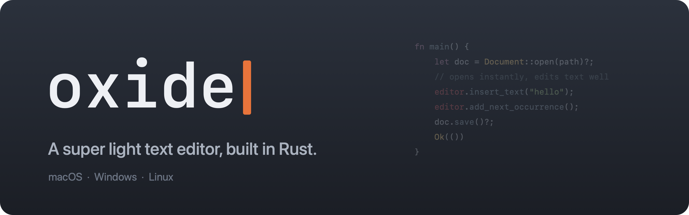
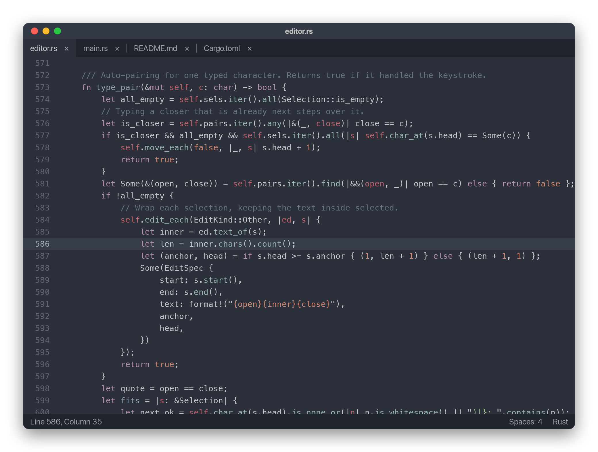
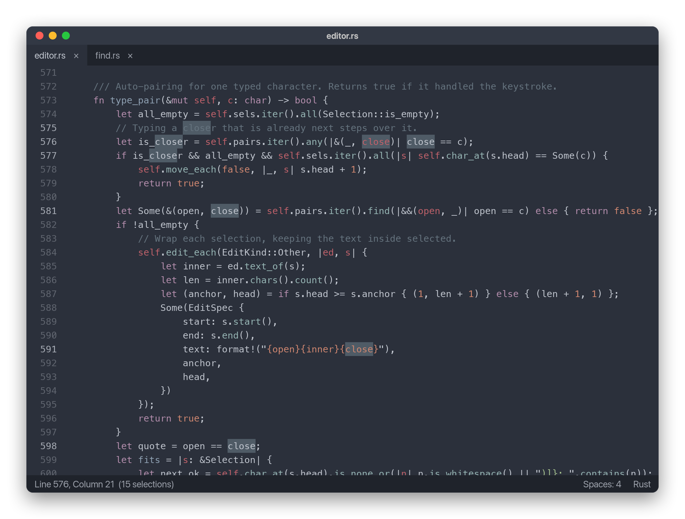
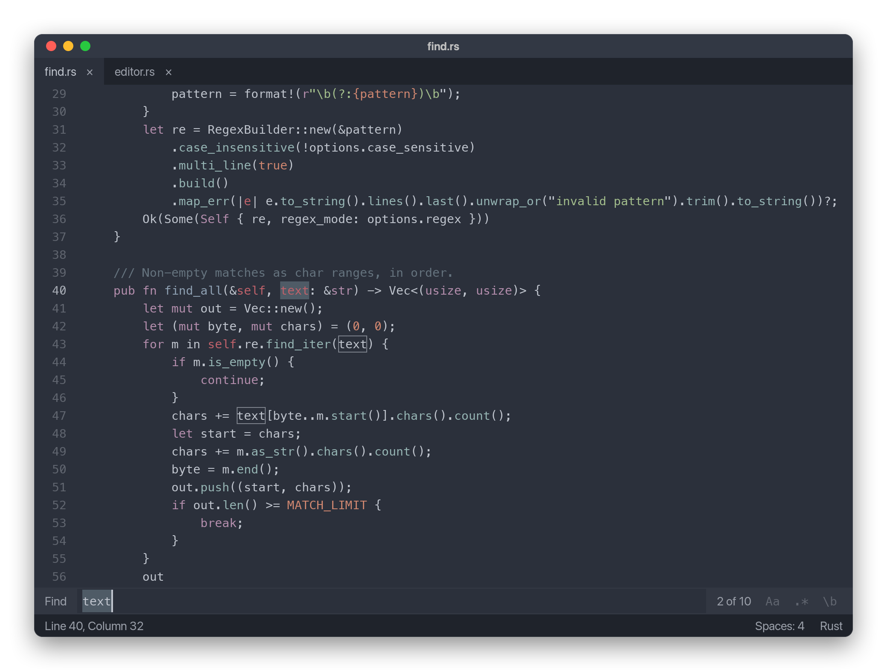
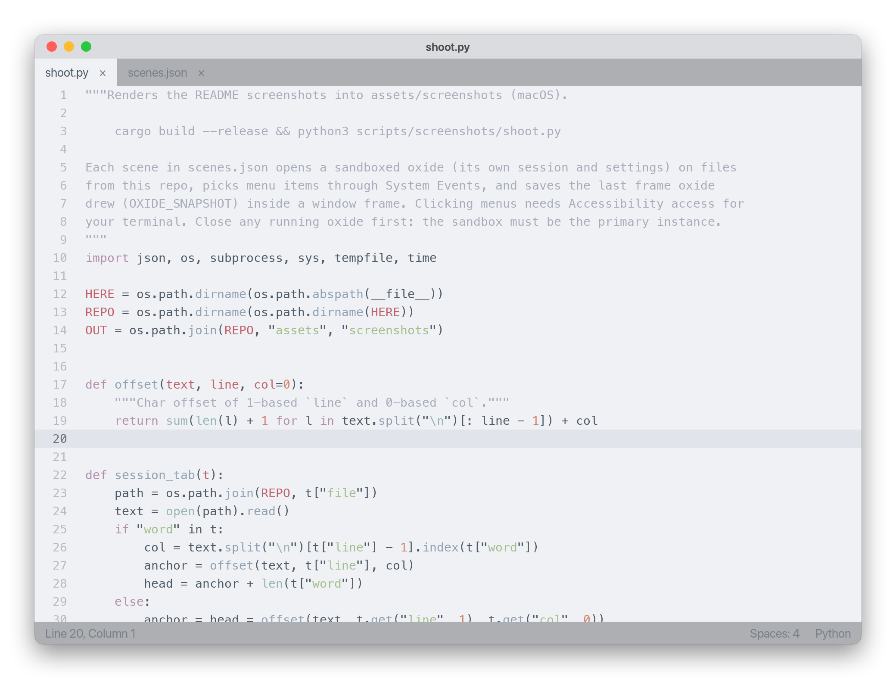

<p align="center">
  
</p>

<p align="center">
  <a href="https://github.com/edkranz/oxide/releases/latest"></a>
  <a href="https://github.com/edkranz/oxide/actions/workflows/ci.yml"></a>
  <a href="https://github.com/edkranz/oxide/releases"></a>
  
  
  <a href="LICENSE"></a>
  <a href="https://github.com/edkranz/oxide/stargazers"></a>
</p>

<p align="center">
  <a href="#install">Install</a> ·
  <a href="#features">Features</a> ·
  <a href="#keyboard-shortcuts">Shortcuts</a> ·
  <a href="#settings-and-formatters">Settings</a> ·
  <a href="#roadmap">Roadmap</a>
</p>

oxide is a super light text editor built in Rust. It's for the edits you make all day:
`ox file` from a terminal, fix a few lines, save, close. It opens before you've finished
thinking about it, highlights your code, formats it on save, and stays out of the way.
It's not an IDE, and doesn't want to be.

<p align="center">
  
</p>

## At a glance

| | |
| --- | --- |
| **~100 ms** | from launch to the first frame on screen |
| **< 10 ms** | for `ox file` to open a tab in the running editor |
| **5.6 MB** | one native binary, no runtime, no Electron |
| **0% CPU** | when idle: nothing redraws unless something changed |

Measured on an M4 Pro MacBook; startup assumes oxide has run once and cached its font list.

## Install

**macOS** (Homebrew):

```sh
brew install --cask edkranz/tap/oxide
```

This installs `Oxide.app` and the `ox` command. `brew upgrade` keeps it up to date.

**Linux**: a `.deb` for Debian and Ubuntu, or a one-line install for everything else
(it puts `oxide` and `ox` in `~/.local/bin`, with a desktop entry):

```sh
# Debian / Ubuntu (x64 shown; arm64 builds are there too)
curl -LO https://github.com/edkranz/oxide/releases/latest/download/oxide_amd64.deb
sudo apt install ./oxide_amd64.deb

# Any distro
curl -fsSL https://raw.githubusercontent.com/edkranz/oxide/main/scripts/install.sh | sh
```

**Windows**: download `Oxide-windows-x64.zip` from the
[latest release](https://github.com/edkranz/oxide/releases/latest), unzip it, and put the
folder on your `PATH` to get `ox`.

**From source** (any platform, Rust 1.88+):

```sh
git clone https://github.com/edkranz/oxide && cd oxide
scripts/install-macos.sh    # macOS: builds Oxide.app into /Applications and links ox
scripts/install-linux.sh    # Linux: installs into ~/.local
cargo build --release       # anywhere: target/release/oxide
```

Every release lists SHA-256 checksums in `SHA256SUMS.txt`.

## Use it

```sh
ox notes.md src/main.rs      # opens each file in a tab
ox --wait COMMIT_EDITMSG     # waits until those tabs close
git config --global core.editor "ox --wait"
```

Or open files from Finder ("Open With", or drop them on the Dock icon), or the app launcher.

Only one oxide runs at a time: `ox` hands its files to it over a local socket and returns
straight away. Quitting keeps your tabs and any unsaved text, and brings them back next
time (hot exit). The session is also saved a couple of seconds after each change, so a
crash loses little.

## Features

<table>
  <tr>
    <td width="50%"></td>
    <td width="50%"></td>
  </tr>
  <tr>
    <td><b>Multiple cursors.</b> Add the next match with <code>Cmd+D</code>, select every match,
    split a selection into lines, or <code>Cmd+click</code>. Every command works on every cursor
    as one undo step.</td>
    <td><b>Find and replace</b> live as you type, with regex, case and whole-word toggles, and a
    match count. Go to any line with <code>Ctrl+G</code>.</td>
  </tr>
  <tr>
    <td></td>
    <td valign="top">
      <ul>
        <li><b>Syntax highlighting</b> for dozens of languages, in a background thread that never
        holds up typing. Add more with <code>.sublime-syntax</code> grammars.</li>
        <li><b>Formatters</b> of your choice (rustfmt, prettier, black, …), on demand or on save.</li>
        <li><b>Themes</b>: built-in light and dark ones, or any <code>.tmTheme</code>.</li>
        <li><b>Hot exit</b>, atomic saves, word wrap, auto-closing brackets, comment toggling,
        smart indentation, zoom.</li>
        <li><b>Native menus</b> on macOS, input methods for every language, and emoji-aware
        cursor movement.</li>
      </ul>
    </td>
  </tr>
</table>

## Keyboard shortcuts

`Cmd` on macOS, `Ctrl` elsewhere. On macOS the same commands are in the menu bar.

| Keys | Action |
| --- | --- |
| `Cmd+S` / `Cmd+Shift+S` | Save / save as (atomic; follows symlinks; keeps line endings) |
| `Cmd+N` / `Cmd+O` | New tab / open files (or drop files on the window) |
| `Cmd+Shift+N` | New window |
| `Cmd+W` | Close tab (press twice to discard unsaved changes) |
| `Cmd+Q` | Quit, keeping unsaved work for next time |
| `Ctrl+Tab`, `Cmd+1`…`9` | Next tab / jump to tab (`Cmd+Shift+[`/`]` on macOS, `Ctrl+PageUp`/`PageDown` elsewhere) |
| `Cmd+Z` / `Cmd+Shift+Z` | Undo / redo (typing is grouped into word-sized steps) |
| `Cmd+C` / `Cmd+X` / `Cmd+V` | Copy / cut / paste (copy or cut with no selection takes the whole line) |
| `Cmd+F` | Find: live as you type; `Enter` / `Shift+Enter` for next / previous |
| `Cmd+Alt+F` (`Ctrl+H` elsewhere) | Find and replace: `Tab` switches fields, `Enter` replaces one, `Cmd+Alt+Enter` (`Ctrl+Alt+Enter`) replaces all |
| `Cmd+Alt+C` / `R` / `W` (`Alt+…` elsewhere) | Toggle case-sensitive / regex / whole-word (or click `Aa` `.*` `\b`) |
| `Cmd+G` / `Cmd+Shift+G` (`F3` / `Shift+F3`) | Find next / previous with the find bar closed |
| `Ctrl+G` | Go to line (`line` or `line:column`, previews as you type) |
| `Cmd+A` | Select all |
| `Cmd+D` | Select the word, then add its next occurrence as another cursor |
| `Ctrl+Cmd+G` (`Alt+F3` elsewhere) | Select every occurrence |
| `Cmd+Shift+L` | Split a selection into one cursor per line |
| `Ctrl+Shift+↑/↓` (`Ctrl+Alt+↑/↓` elsewhere), `Cmd+click` (`Ctrl+click`) | Add a cursor |
| `Escape` | Back to one cursor |
| `Cmd+/` | Toggle comment |
| `Alt+Z` | Toggle word wrap for the tab (`word_wrap` in settings sets the default) |
| `Tab` / `Shift+Tab` | Indent / outdent (whole lines when the selection spans several) |
| `Alt+←/→` (`Ctrl` elsewhere) | Move by word; add `Shift` to select |
| `Cmd+←/→`, `Home`/`End` | Line start (smart: indentation first) / end |
| `Cmd+=` / `Cmd+-` / `Cmd+0` | Zoom in / out / reset |
| `Shift+Alt+F` | Format the file with its formatter add-on |
| `Cmd+,` | Open settings |

Double-click selects a word, triple-click a line. Middle-click a tab to close it.
Every editing command works on all cursors at once, as one undo step. Brackets and quotes
complete as you type (and step over / delete as a pair); Enter between brackets opens an
indented line. The caret moves over emoji and accented letters as single characters.
Input methods (Chinese, Japanese, Korean, accented characters) are supported.

## Settings and formatters

`Cmd+,` opens `~/.config/oxide/settings.toml` (`%APPDATA%\oxide\settings.toml` on Windows),
created with every option commented. Saving it applies the changes immediately.

```toml
font_family = "JetBrains Mono"
font_size = 14
theme = "base16-ocean.dark"     # built in, or NAME.tmTheme in ~/.config/oxide/themes/
tab_size = 4
translate_tabs_to_spaces = true
detect_indentation = true
format_on_save = true

# A formatter reads the file on stdin and prints the result; $FILE is the file's path.
[[formatter]]
extensions = ["rs"]
command = ["rustfmt", "--edition", "2021", "--emit", "stdout"]

[[formatter]]
extensions = ["js", "ts", "json", "css", "md"]
command = ["prettier", "--stdin-filepath", "$FILE"]
```

Formatting runs in the background, applies only the lines that changed as one undo step,
and keeps your caret where it was. If a formatter fails, the file still saves.

## Add-ons

Drop syntax definitions (`.sublime-syntax` YAML grammars) into `~/.config/oxide/syntaxes/`
(`%APPDATA%\oxide\syntaxes\` on Windows) to add languages.

Debugging: `OXIDE_TRACE=1` prints startup timings; `OXIDE_SNAPSHOT=frame.bmp` writes every
frame to an image.

## How it works

Two rules keep it fast: own the whole rendering pipeline, and keep anything slow off the
thread that handles typing.

- **`document.rs`**: the text as a rope (`ropey`), so edits are O(log n) on any size of file,
  with undo history and saved/dirty tracking.
- **`editor.rs`**: editing commands that only need the text (typing, deleting, word moves).
- **`highlight.rs`**: a background thread per document runs regex-based syntax grammars
  (`syntect`). It stores parser state at each line start, so after an edit it
  re-parses only until the state converges with the previous pass, usually a line or two.
  The UI draws plain text until colours arrive and never waits for them.
- **`render.rs`**: CPU rendering, which starts faster than a GPU pipeline. `cosmic-text` shapes lines
  (with font fallback), `swash` rasterises glyphs, and pixels are blended straight into the
  window buffer (`softbuffer`). Shaped lines are cached between frames.
- **`find.rs`**: find and replace on top of the `regex` crate; literal queries are escaped
  so both modes share one path.
- **`instance.rs`** and **`session.rs`**: the single running instance and hot exit.
- **`window.rs`**: tabs, the find and go-to bar, input, scrolling, and painting a frame. Nothing redraws unless something
  changed, so an idle window uses no CPU.

## Roadmap

1. ~~**Daily-driver basics**: find and replace, go to line, tabs, open and save-as
   dialogs, input methods (IME).~~ Done.
2. ~~**Instant re-open**: one running instance; `ox file` hands the path over a socket
   and opens a tab in milliseconds. Hot exit, so unsaved buffers survive quitting.~~ Done.
3. **Feel**: ~~multiple cursors, auto-closing brackets, comment toggling, settings
   file, word wrap~~ (done); a minimap.
4. **Add-ons**: ~~declarative formatters, themes, and syntaxes~~ (done); keymaps; then
   sandboxed WASM add-ons for anything needing code. A public registry later.
5. **LSP as an add-on**, not core. The core will expose popups, underlines, and
   UTF-16 positions so it can be added without a rewrite.

Startup: after the first launch, oxide loads only the font files it used last time
(`fonts.json` in its data folder) and scans the rest in the background, so a cold start
doesn't wait on the whole font library.

Known limits today: lines over 16 KB aren't highlighted; Windows and Linux have no menu
bar yet (every command has a shortcut).

## Releases and contributing

Versions come from commit messages, written as
[conventional commits](https://www.conventionalcommits.org): `feat: …` for a new feature,
`fix: …` for a bug fix, `docs:`, `ci:`, `chore:` and so on for everything else.
[release-please](https://github.com/googleapis/release-please) keeps a release PR open
with the next version number and changelog. Merging it tags the release, and the
[release workflow](.github/workflows/release.yml) builds macOS, Windows and Linux packages,
attaches them to the GitHub release, and updates the Homebrew cask.

Every push is built, linted and tested on macOS, Windows and Linux by [CI](.github/workflows/ci.yml).
Issues and pull requests are welcome.

## Star history

<a href="https://star-history.com/#edkranz/oxide&Date">
  
</a>

## License

MIT. See [LICENSE](LICENSE).
